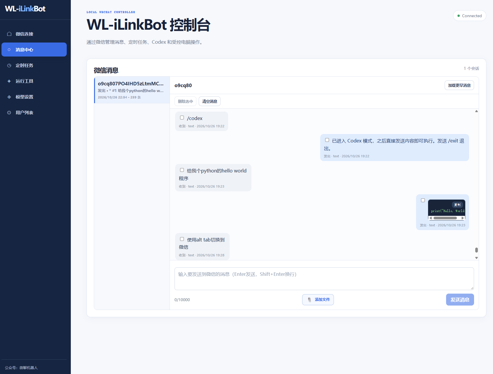
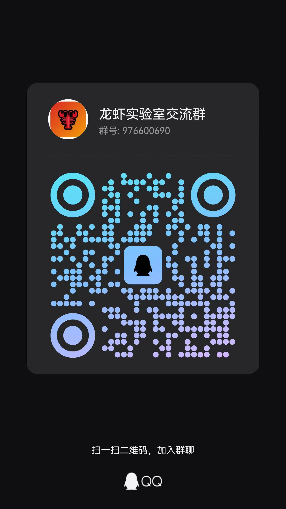

# iLinkBot

iLinkBot 是一个运行在 Windows 本机的微信 AI 助手。它通过微信 iLink Bot 通信协议接收消息，在本机调用 Codex 或大模型完成任务，并提供 React 网页控制台管理消息、工具和定时任务。



## 核心能力

- **微信连接本机 AI**：通过微信发起任务，在本机处理项目、文件和图片，再将结果发回微信。
- **连续 Codex 会话**：支持新建、查看、切换和恢复会话，适合持续调试或修改项目。
- **受控电脑操作**：支持截图、窗口控制和白名单命令；桌面输入与点击取决于本机适配能力。
- **自动生成工具**：使用自然语言生成可复用的文本工具，审核启用后重复调用。
- **定时任务与提醒**：支持一次性提醒、重复任务、Cron 表达式和执行记录。
- **常用 AI 工具**：提供翻译、总结、OCR、会议纪要、待办、邮件和格式转换。
- **消息中心**：保存双向消息，支持 Markdown、长消息分片以及图片和文件附件。

系统由两个进程组成：

- `backend/`：Python、FastAPI、SQLite
- `frontend/`：React、Vite

## 环境要求

- Windows 10/11
- Python 3.10+（推荐使用 Conda）
- Node.js 18+ 和 npm
- 可正常扫码的微信环境
- 可选：已安装并可在终端运行的 Codex CLI

## 快速开始

### 1. 启动后端

在项目根目录打开 Anaconda Prompt 或已初始化 Conda 的 PowerShell：

```powershell
conda create -n ilinkbot python=3.12 -y
conda activate ilinkbot
cd backend
python -m pip install -e ".[dev]"
Copy-Item .env.example .env
python -m app
```

后端默认地址为 `http://127.0.0.1:3210`，健康检查地址为 `http://127.0.0.1:3210/api/health`。

### 2. 启动前端

另开一个 PowerShell 窗口：

```powershell
cd frontend
npm install
npm run dev
```

打开 `http://127.0.0.1:5173`。

### 3. 连接微信

1. 在“微信连接”页面等待二维码出现。
2. 使用微信扫码并确认登录。
3. 等待连接状态变为 `connected`。
4. 从微信向机器人发送一条消息，以建立可用于回复、提醒和定时任务的用户上下文。

## 常用指令

### Codex 会话

```text
/codex 请检查当前项目
/new
/sessions
/session 2
/exit
```

### 工具与任务

```text
/translate 内容
/summary 内容
/meeting 内容
/todo 添加任务
/remind 20分钟后提醒我开会
/repeat 每天9点发送天气
/ocr
/convert pdf
```

### 自动生成工具

```text
/create-tool 把客服回复改写得礼貌专业
/run-tool confirm 工具ID 输入内容
/tools
```

生成的工具必须先在网页“运行工具”中审核启用。它们只处理文本，不能执行 Shell、任意读写文件或直接产生外部副作用。

### 邮件与电脑控制

```text
/mail 收件人 | 主题 | 正文
/mail confirm
/mail cancel
/control 命令ID
```

邮件需要先预览再确认发送；电脑控制只接受白名单中的命令 ID。

## 模型与配置

可以在网页“模型设置”中选择 Codex 或大模型 API，也可以编辑 `backend/.env`。

| 配置 | 说明 |
| --- | --- |
| `HOST`、`PORT` | 后端监听地址和端口 |
| `CODEX_COMMAND` | Codex 命令或完整路径 |
| `CODEX_WORKDIR` | Codex 工作目录 |
| `OPENAI_API_KEY` | 大模型 API 密钥 |
| `OPENAI_MODEL` | API 模型名称 |
| `OPENAI_BASE_URL` | API 服务地址 |
| `OPENAI_API_MODE` | `responses` 或兼容模式 |
| `CONTROL_ALLOWLIST` | 电脑控制白名单配置 |

邮件功能还需要配置 `SMTP_HOST`、`SMTP_PORT`、`SMTP_USER`、`SMTP_PASSWORD`、`SMTP_FROM` 和 `SMTP_SSL`。

## 安全说明

- 后端默认只监听 `127.0.0.1`，不了解风险时不要改为公网地址。
- 控制命令必须预先写入 [control_allowlist.json](backend/config/control_allowlist.json)，不接受微信传入的任意 Shell 指令。
- `.env`、`backend/data/`、SQLite 数据库和微信凭证不应提交到 Git 或分享给他人。
- 单个普通附件最大 20 MB，OCR 图片最大 10 MB。
- 定时任务依赖后端持续运行，电脑关机或后端退出后不会继续执行。
- iLink 上下文接近过期时，机器人会提醒用户回复消息以续期，并避开凌晨时段。

## 常见问题

- **页面打不开**：确认后端和前端均已启动，并检查 `3210`、`5173` 端口。
- **二维码不显示**：确认后端仍在运行，刷新页面或点击“重新连接”。
- **找不到 Codex**：运行 `codex --version`；必要时在 `.env` 中把 `CODEX_COMMAND` 改为完整路径。
- **定时任务未发送**：检查后端进程、任务状态、执行时间、微信连接以及目标用户上下文。
- **控制命令被拒绝**：确认命令 ID 已配置在控制白名单中。

更完整的功能介绍和使用场景请查看 [iLinkBot v8.0](iLinkBot-v8.0.md)。

更多 AI 效率工具：龙虾实验室 （https://www.longxialab.cn/）  
QQ 交流群：