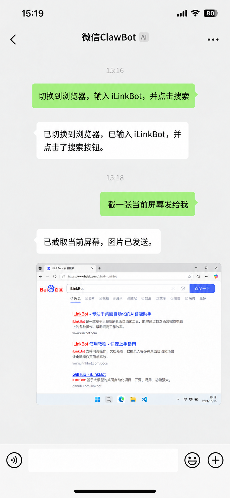
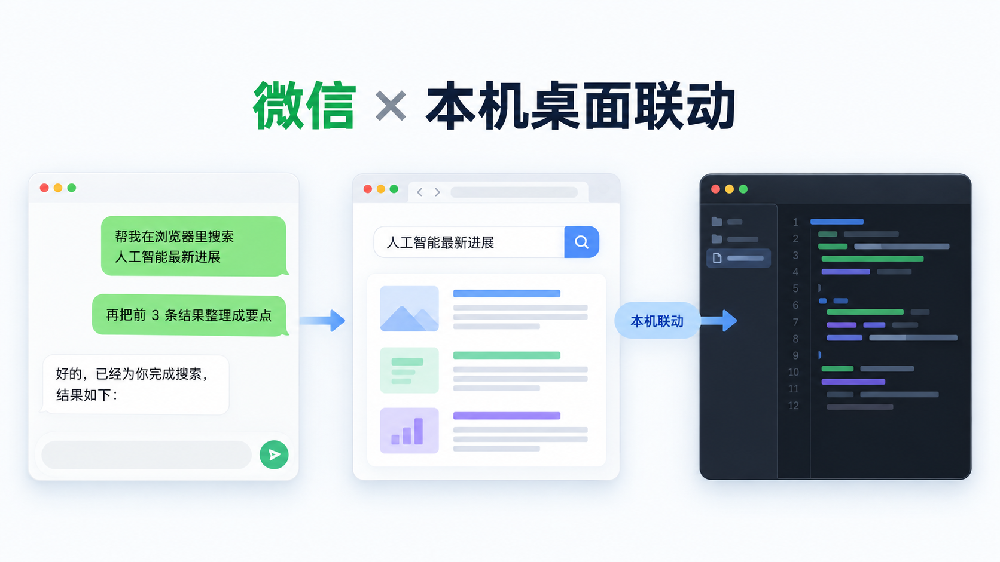
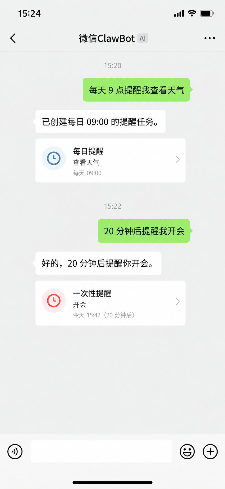
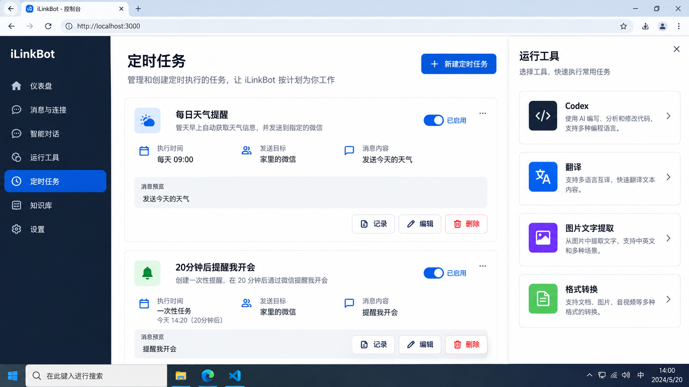

# 微聊机器人 v8.0 正式上线：把微信变成电脑的 AI 入口
WL-iLinkBot 使用微信官方协议，完全合规。

开源项目地址：https://gitee.com/aileaf/wl-ilinkbot

很多人第一次听到“用微信控制电脑”，想到的可能是一个会自动回复的机器人。但真正用起来，你会发现，自动回复只是最基础的一层能力。这也正是微信龙虾的功能。

当你在微信里说一句“把当前电脑截图发给我”，机器人应该真的把截图带回来；当你说“20 分钟后提醒我开会”，它应该在时间到了以后主动发消息；当你把一份文件发过去，它应该能帮你识别、总结或转换，而不是只回复一句“我收到了”。

微聊机器人 v8.0，就是围绕这些真实需求做出来的。

它使用微信随 ClawBot（龙虾插件）（微信龙虾）正式放出的 iLink Bot 通信协议。iLink 的作用，是在个人微信和 AI Agent 之间建立一条官方的通信通道。它不是通过逆向 hook 去“接管”微信，而是使用官方提供的 Bot 能力，把微信消息安全地转交给运行在你自己电脑上的 Agent，再把处理结果送回微信。

因此，使用 iLinkBot 时，你不需要学习一套新的聊天软件。微信仍然是入口，电脑仍然是能力发生的地方，AI 则负责理解你说的话并完成任务。


## 1 从一条微信消息开始，完成一次真正的自动化

### 1.1 使用方式

iLinkBot 最适合的使用方式，不是把它当成一个只能问答的机器人，而是把它当成一个随时可以联系的个人工作助手。

你可以在外面用手机发一句话，让家里的电脑处理项目文件；可以把会议照片发到微信，让它提取文字并整理成纪要；也可以在控制台里设置一个每天执行的任务，让机器人到了时间主动提醒你。

### 1.2 系统组成

这些动作背后由几个部分协同完成。后端运行在 Windows 本机，负责连接 iLink、接收微信消息、调用 Codex 或大模型、保存消息记录并执行定时任务。前端是一个 React 控制台，用来扫码连接微信、查看历史消息、管理用户和任务。SQLite 则负责保存消息、任务、运行记录和用户信息，所以你不需要额外部署数据库。

整个系统默认只监听本机地址 `127.0.0.1`。也就是说，项目更像是一台属于你自己的本地工作台，而不是一个暴露在公网的机器人服务。


*图：消息中心的控制台示意图。左侧可以切换微信连接、消息中心、定时任务和运行工具，右侧查看会话、Markdown 内容并发送消息。*

## 2 电脑控制亮点：切换软件、键盘输入、鼠标点击

### 2.1 操作场景

iLinkBot 最有吸引力的地方，往往不是“它能调用哪个模型”，而是它能不能真的帮你操作电脑。v8.0 的电脑控制场景，正是围绕这种直观需求展开的：你可以在微信里描述一个操作流程，让 Agent 先切换到目标软件，再输入文字，最后完成鼠标点击。当前项目已经提供窗口切换、窗口聚焦、截图和白名单控制基础；键盘输入与鼠标点击则应配合本机启用的桌面控制适配使用。

比如，你可以说：“切换到浏览器，打开工作页面，在搜索框输入项目名称并点击搜索。”也可以说：“切换到记事本，输入下面这段内容，然后点击保存。”对于需要重复完成的桌面工作，这种表达比记住一串复杂命令更接近日常使用习惯。

### 2.2 执行步骤

这类操作通常可以拆成三个连续动作。第一步是找到并切换到目标窗口，必要时将窗口恢复或最大化；第二步是把用户提供的内容输入当前窗口，例如输入搜索词、文件名或回复内容；第三步是在明确的界面位置执行鼠标点击，例如点击搜索、确认、保存或发送按钮。执行过程中，用户仍然可以通过微信继续补充要求，也可以让机器人返回截图确认当前界面状态。

### 2.3 安全边界

需要特别说明的是，电脑控制不是把电脑命令行直接暴露给微信。当前项目的安全设计是受控执行：窗口聚焦、截图和命令执行都受到本机配置、白名单和运行环境限制，控制命令会记录到运行日志中；是否能完成某个具体软件的键盘输入或鼠标点击，也取决于本机已配置的桌面控制能力和当前窗口状态。换句话说，v8.0 强调的是“用微信描述操作意图”，而不是允许微信无条件执行任意程序或脚本。

对于普通用户，可以把它理解为一位坐在电脑前的助手：你告诉它应该切换到哪个软件、输入什么内容、点击哪个按钮，它负责按步骤执行；遇到不确定的界面，则先截图或反馈状态，再继续下一步。这样的方式尤其适合处理重复录入、网页查询、资料整理和跨软件搬运信息等工作。

### 2.4 自动生成工具

除了直接执行已有功能，iLinkBot 还可以根据自然语言描述生成可复用的小工具。你可以发送 `/create-tool`，说明希望自动完成的文本处理流程，例如把客服回复改写得更礼貌、把会议记录整理成行动项，系统会先生成结构化工具定义，再交给你审核。确认启用后，可以通过 `/run-tool` 重复调用。

这个能力把“临时需求”变成了“可复用流程”，但仍然保留安全边界：生成工具只负责文本处理，必须人工审核后才能启用，不能执行 Shell、读取任意文件或直接产生外部副作用。



*图：根据你提供的微信交互截图制作的桌面控制示意图，展示“切换浏览器、输入内容、点击搜索、返回截图”的完整对话过程。*

## 3 第一次使用：先连接微信，再让机器人认识你

### 3.1 环境准备

项目需要 Windows 10/11、Python 3.10 以上版本、Conda、Node.js 18 以上版本，以及可以正常扫码的微信环境。

开源项目地址：https://gitee.com/aileaf/wl-ilinkbot

### 3.2 启动服务

第一次启动后端时，在项目根目录打开 Anaconda Prompt 或已经初始化 Conda 的 PowerShell，执行：

```powershell
conda create -n ilinkbot python=3.12 -y
conda activate ilinkbot
cd backend
python -m pip install -e ".[dev]"
Copy-Item .env.example .env
python -m app
```

后端默认运行在 `http://127.0.0.1:3210`，可以打开 `http://127.0.0.1:3210/api/health` 检查服务是否正常。

然后再打开一个 PowerShell 窗口启动网页控制台：

```powershell
cd frontend
npm install
npm run dev
```

### 3.3 首次连接

浏览器访问 `http://127.0.0.1:5173`，进入“微信连接”页面，等待二维码出现，用微信扫码并确认登录。当页面显示 `connected` 后，建议立刻从微信给机器人发一条普通消息，例如“你好，建立连接”。

这一步很重要。iLinkBot 只有在收到过某个用户的消息后，才能保存这个用户的有效上下文。之后，你才可以在网页里选择这个用户主动发消息，也才能把他设置为提醒和定时任务的接收人。系统不会让你随便手填用户 ID 或上下文令牌，这样可以减少误发，也可以避免敏感上下文被滥用。

## 4 消息中心：不只是聊天记录，而是一个可操作的工作区

### 4.1 会话与消息展示

进入“消息中心”后，你看到的不再是一串孤立的日志，而是按照用户整理好的双向消息记录。机器人收到的内容和发出的内容会分别标记方向，用户备注也会显示在会话列表里。你可以给用户设置“家里电脑”“工作微信”之类的备注，下一次回来时不用再对着一串 ID 猜测对象。

消息中心支持 Markdown 显示。Codex 返回的标题、列表、引用和代码块，会尽量按照原来的结构展示；代码块保留 fenced 标记，发送到微信后也方便复制。对于较长的内容，系统会自动分片发送，并尽量保持代码块的完整性，避免一段代码被切在中间导致无法阅读。

### 4.2 发送与管理

在网页里发送消息也很简单。选择一个已经建立有效上下文的用户，输入文字后按回车即可发送，`Shift + Enter` 用于换行。文件和图片按钮放在发送区域旁边，可以直接选择附件。收到新消息或发送新消息后，消息区域会自动滚动到底部，适合长时间跟踪一个任务。

页面还提供选中删除和清空当前消息视图的操作。如果你只是想整理当前页面，这些操作很方便；真正需要长期保存的消息、运行记录和调度记录仍由后端数据库管理。

普通文件单个最大 20 MB，OCR 图片最大 10 MB。需要留意的是，项目升级前保存的旧消息可能只有最多 2000 字符的摘要，超出的旧内容无法恢复。

## 5 Codex 模式：像和一个能动手做事的同事持续对话

不仅仅是 Codex，也可以接入其他 AI 工具。

如果你只想让模型回答一条问题，可以直接发送：

```text
/codex 请检查当前项目的测试失败原因
```

如果你准备连续讨论一个任务，建议单独发送 `/codex` 进入 Codex 模式。进入以后，你可以像平常聊天一样继续发送内容，后续消息会沿用当前会话，而不是每次都重新开始。

例如，你可以先说“检查这个项目的启动方式”，等它完成后再说“把刚才发现的问题整理成修复计划”，最后再说“现在直接修改代码并运行测试”。这类连续工作正是 Codex 模式的价值所在。

如果想换一个完全不同的主题，可以发送 `/new` 或 `/n` 新建会话。发送 `/sessions` 或简写 `/ss` 可以查看会话列表，每页显示 5 个会话，并带有会话标题；发送 `/session 2` 可以切换到第二个会话。完成后用 `/exit` 退出当前模式。

### 5.1 会话连续性

项目历史记录里曾经出现过一个很明显的问题：微信每发来一条消息，系统就新建一个 Codex 会话，导致上下文无法连续。现在，后端会按用户保存当前会话，并使用 Codex 的 resume 能力继续工作。需要说明的是，这个连续会话状态目前保存在后端进程内，重启后端后需要重新进入 Codex 模式建立新会话；消息和运行记录本身仍然会保存在 SQLite 中。

### 5.2 让截图和文件真的回到微信

Codex 模式可以接收图片和文件。如果你把图片发过去并要求“帮我识别这张图里的文字”，它会把附件作为当前任务的输入；如果你要求“分析这个 PDF 并给出三条结论”，系统会把文件交给 Codex 处理。

当 Codex 生成截图、报告或其他文件时，最好明确说“请把文件发送到微信”。系统会识别结果中明确引用的本地文件路径，也支持这样的标记：

```text
[send_to_wechat:reports/result.pdf]
```

只有文件真实存在、类型受支持、大小不超过 20 MB 时才会作为附件发送。相对路径会限制在 `CODEX_WORKDIR` 目录下，系统也不会因为诊断日志里出现 `.env`、数据库或微信凭证路径，就把这些敏感文件发送出去。

项目还专门增加了 Codex 结果后处理。以前微信里可能会看到版本号、工作目录、模型信息、`exec` 日志和 `tokens used` 等内部内容，现在这些 CLI 噪声会被清理，只把最终答案发送给用户。



*图：项目运行现场截图，展示微信窗口、本机开发环境与 Codex 工作区之间的联动。*

## 6 工具中心：把常用需求变成一句话

### 6.1 常用工具

不是所有事情都需要进入 Codex。对于翻译、总结、提醒、格式转换这些明确任务，直接使用工具会更快。

你可以发送 `/translate`、`/summary`、`/abstract` 或 `/meeting`，分别完成翻译、总结、摘要和会议纪要。会议纪要会尝试整理议题、结论、待办、负责人和截止时间，适合把一段聊天记录或会议转写结果直接交给机器人处理。

待办事项也可以完全在微信里管理。发送 `/todo 添加任务` 会创建一条待办，发送 `/todo list` 查看列表，发送 `/todo done 1` 完成编号为 1 的任务。不同微信用户的待办彼此隔离，不会混在一起。

图片识别使用 `/ocr`。你可以先发送图片，再附带 `/ocr`，也可以在网页运行工具页面里上传图片。格式转换使用 `/convert`，目前支持图片转 PDF、JSON 与 CSV 互转、TXT 与 Markdown 互转，以及 Markdown 转 HTML。系统会拒绝不明确或不安全的转换组合，不会把任意文件交给未知程序处理。

### 6.2 邮件与自定义工具

邮件功能也保留了确认步骤。发送：

```text
/mail 收件人 | 主题 | 正文
```

机器人会先把邮件内容预览给你，只有再次发送 `/mail confirm` 才会真正通过 SMTP 发出；如果改变主意，可以发送 `/mail cancel`。邮件也支持添加附件。这个设计看起来多了一步，但能有效避免误发。

如果你有一个反复使用的文本处理流程，可以发送 `/create-tool`，用自然语言描述你希望工具做什么。机器人会生成一个结构化工具定义，但不会立即启用；你需要在网页的“运行工具”页面检查并审核，确认后才能通过 `/run-tool confirm 工具ID 输入内容` 使用。生成工具只负责文本处理，不能执行 Shell、读取文件或直接产生外部副作用。

当你不确定该使用哪个工具时，可以直接用自然语言描述需求。未进入特定模式时，系统会尝试自动判断你需要翻译、总结、提醒、待办或其他工具；如果只是问候或闲聊，它不会强行执行某个工具。

## 7 定时任务：让机器人主动来找你

### 7.1 微信指令

定时任务是这个项目最早的核心需求之一。你不需要每天记得打开网页，只要创建一次任务，后台调度器就会在指定时间通过微信发送消息。

一次性提醒可以直接这样说：

```text
/remind 20分钟后提醒我开会
```

重复任务可以这样说：

```text
/repeat 每天9点发送天气
```

### 7.2 网页调度与运行条件

网页“定时任务”页面则适合管理更复杂的安排。你可以选择每 5 分钟、每 15 分钟、每小时、每天、每周或每月执行，也可以自己填写 Cron 表达式；一次性任务可以直接选择日期和时间。任务创建以后，可以查看执行记录、修改内容、停用或删除任务。

定时任务有两个前提。第一，目标用户必须以前给机器人发过消息，系统需要有有效的 iLink 上下文。第二，后端进程必须一直运行，因为调度器就在后端进程中工作。如果电脑关机或后端被关闭，任务不会在后台继续执行。



*图：根据你提供的微信聊天截图制作的定时任务示意图，展示每日提醒和一次性提醒创建后的反馈。*



*图：定时任务页面示意图，展示每日天气提醒、一次性提醒，以及右侧的 Codex、翻译、OCR 和格式转换工具入口。*

## 8 连接保活：避免“任务还在，微信却断了”

iLink 连接有效期按用户最后一次发消息的时间计算，目前是 24 小时。系统会在预计过期前一小时开始提醒，每隔 10 分钟提示一次用户回复任意消息。如果预计过期时间落在凌晨 0 点到早上 6 点，提醒会提前到前一天晚上 23:00 至 23:50，凌晨时段不会打扰你。

这项功能来自实际使用中的一个问题：定时任务看起来一切正常，但微信上下文已经过期，最终消息无法送达。现在，机器人会主动提醒你续期。你只需要回复一句“收到”，连接有效期就会重新计算。

## 9 用微信控制电脑，但不把电脑暴露给微信

iLinkBot 可以执行一些受控的电脑操作，例如查看 Windows 版本、查看当前目录、列出项目文件、查看桌面文件、获取系统信息和网络配置。

使用时先发送 `/control` 进入控制模式，再发送命令 ID；也可以在网页中执行相同的控制命令。系统只接受 `backend/config/control_allowlist.json` 中提前写好的固定命令，不接受从微信传入的任意可执行文件路径、参数或 Shell 字符串。

这意味着它不是“把一台电脑的命令行直接接到微信上”，而是把少量经过审核的动作放进一个可记录、可审计的白名单里。控制结果会保存到运行记录中，默认监听地址也只允许本机访问。除非你非常清楚网络暴露带来的风险，否则不要把 `HOST` 改成公网地址。

## 10 模型设置：选择适合自己的工作方式

在“模型设置”页面，可以选择 Codex 或大模型 API。

Codex 模式适合需要访问项目目录、处理本机文件或进行受控电脑操作的任务；OpenAI API 模式更适合翻译、总结、OCR、会议纪要和工具编排等模型工作。OpenAI API 支持 Responses API，也支持兼容 Chat Completions 的服务。

也可以直接编辑 `backend/.env`：

```dotenv
AI_PROVIDER=codex
CODEX_COMMAND=codex
CODEX_WORKDIR=.
CODEX_TIMEOUT_SECONDS=120

# 使用 OpenAI API 时填写
OPENAI_API_KEY=
OPENAI_MODEL=gpt-4o-mini
OPENAI_BASE_URL=https://api.openai.com/v1
OPENAI_API_MODE=responses
```

如果终端中执行 `codex --version` 提示找不到命令，请把 `CODEX_COMMAND` 改成完整可执行文件路径。模型设置页面不会回显密钥，`.env`、数据库、微信凭证和消息数据也不应提交到 Git 或分享给其他人。

## 11 普通用户最实用的几种用法

如果你只是想快速开始，可以把它当成三种不同的助手来使用。

第一种是“随时问、随时做”的微信助手。你在手机上发问题、图片或文件，它在本机完成处理，再把结果发回来。适合查项目、做翻译、整理资料和处理临时任务。

第二种是“持续协作”的 Codex 助手。先发送 `/codex`，围绕一个主题连续对话；需要换主题时用 `/n`，需要查看已有会话时用 `/ss`。这种方式特别适合调试项目、修改代码和反复确认结果。

第三种是“主动提醒”的自动化助手。把每天、每周或某个具体时间需要做的事情交给定时任务，之后只需保持后端运行。适合天气提醒、会议提醒、周期性工作提示和固定内容推送。

在实际使用中，建议把微信用于发起任务和接收结果，把网页控制台用于查看历史、管理定时任务、审核工具和修改模型设置。这样既保留微信的方便，也不会把所有管理功能堆在聊天窗口里。

## 12 常见问题

如果网页打不开，先确认后端和前端是否都已启动，并检查 `3210` 和 `5173` 端口是否被占用。前端的 `/api` 请求会代理到后端，所以只启动前端是无法完成微信连接的。

如果二维码不显示，确认后端进程没有退出，再刷新页面或点击“重新连接”。如果登录凭证已经失效，删除 `backend/data/wechat` 后重新扫码。

如果 Codex 找不到，先在终端执行 `codex --version`，然后检查 `.env` 中的 `CODEX_COMMAND`、`CODEX_WORKDIR` 和超时时间。若定时任务没有发送，则检查后端是否持续运行、任务是否启用、时间表达式是否有效，以及目标用户是否建立过微信上下文。

## 13 结语：入口仍是微信，能力已经属于你的电脑

好的个人自动化，不应该要求你记住十几个后台地址，也不应该把每一次操作都变成复杂的配置流程。它应该像发消息一样自然：你说清楚要做什么，系统负责理解、执行，并把结果带回来。

微聊机器人 v8.0 做的事情，就是把这种自然的交互方式和本机 AI Agent、定时调度、文件处理、电脑控制结合起来。

你不需要先成为自动化专家。先从一句 `/codex`、一次图片 OCR，或一个“20 分钟后提醒我开会”开始。等你真正用起来，会发现微信只是入口，而你的电脑已经多了一位可以持续协作的助手。

功能持续更新与优化中，最新消息请前往“龙虾实验室”。

